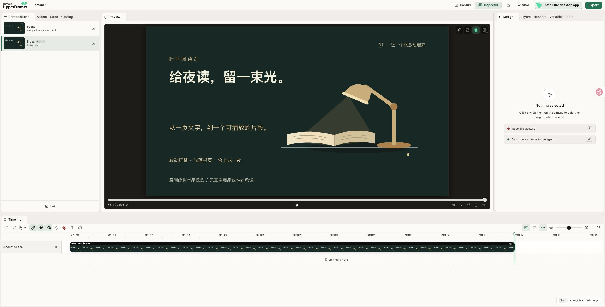

# 让一页文案、一组数字，变成能播放的视频

你想给自己的小产品做一个开场片：一句标题、一盏灯、书页上的光依次出现。临时打开剪辑软件当然可以，但如果下次只改一句标题、下周只换四个数字，你可能更希望留下一个能反复生成的模板。

HyperFrames 做的是这件事：把网页里的文字、图形和动画时间线，逐帧渲染成普通 MP4。**会写网页的人可以控制画面；不会写动画的人，可以先改本包的中文内容文件，复用两个原创示例。**它不会仅凭一句要求自动保证高质量成片；构图、节奏和素材仍要有人设计。

我们实跑了两条不同路径：一条用原创阅读灯插画做 12 秒产品概念片，另一条让四周借阅数字依次长成柱状图。它们都是连续动画，不是几张文字卡轮播。灯是虚构概念，数字是虚构示例，没有真实商品或统计结论。


## 先做第一条

准备 Node.js 22 或更新版本、Chrome/Chromium，以及 FFmpeg。首次安装依赖需要联网；本例不需要模型密钥、付费素材或云账号。具体安装方式见 [DEPLOY.md](DEPLOY.md)。

进入本文件所在目录：

```bash
node run.mjs preview-product
```

macOS/Linux 也可执行 `bash start.sh`；Windows 可双击 `start.cmd`。首次启动会用锁文件安装固定版本，生成示例，再给出浏览器地址。打开 `http://127.0.0.1:18831/#project/product`，等时间轴显示 **00:00/00:12**，拖动进度条或点击 Play。如果刚打开短暂显示 No compositions found，先等加载完成，不要马上重新安装。



导出视频：

```bash
node run.mjs render-product
```

成功后得到 `renders/product.mp4`，本次实测是 1920×1080、30 帧/秒、12 秒、无声。用常见播放器打开，确认灯臂在约2秒后转动、光束在约3秒后显现，再看最终中文文案。**浏览器里能预览，不等于已成功导出；一定要检查 MP4。**

## 换成自己的内容

打开 `content.json`，改 `product.headline` 的中文标题，例如把“给夜读，留一束光。”改成“让书页，慢慢亮起来。”；保存后重新执行上面的导出命令。`build.mjs` 每次根据这个文件生成画面，所以不要只修改 `projects/` 中临时生成的 HTML。

产品的 name/headline/detail/label 每项限制60个字符；长标题仍可能溢出，导出前必须看预览。我们实际修改标题并重新导出，确认视频中的标题变化；原画面文件不会自动改名，留存旧片请先复制备份。

## 第二条：让数字说出变化


```bash
node run.mjs preview-data
node run.mjs render-data
```

预览端口是18832，输出为 `renders/data.mp4`。`content.json` 的 `data.values` 是四个正数，`labels` 是对应标签，单位和来源也在同一处。柱子按先后顺序长出，最后突出第四周；上限根据最大值向上取20的整倍数，避免改数字后比例失真。

我们把第四周从76改为64再导出，核对标签、柱高和注释随输入变化。你可以用自己的合法数据替换，同时把“虚构示例”改成准确的数据来源。不要仅换一个数字却继续保留不成立的标题或结论。

## 用完后与下一步

```bash
node run.mjs stop-product
node run.mjs stop-data
```

关闭浏览器标签不会停止后台服务；上面的命令才会停止对应预览。本次已验证停止后不可访问、重启后恢复。文件本身保留在本机，视频可复制到剪辑软件继续配音或配乐。

进阶修改从 `build.mjs` 的两个 scene 开始：HTML/CSS 管排版，SVG 管灯与书，GSAP 管“第几秒开始、持续多久”的时间线。GSAP 是网页动画库；这里使用暂停且可按时间跳转的动画，方便 HyperFrames 逐帧捕获。不要换成只会随真实时钟运行的 setInterval，否则预览与导出可能不一致。

本包交付的是原创中文入口、两个可复用案例和经过验证的运行方法。它不是完整中文化的 HyperFrames 编辑器，也不承诺任何素材都能一键变成专业广告。平台和硬件实测边界见 DEPLOY；故障恢复见 FAQ。
